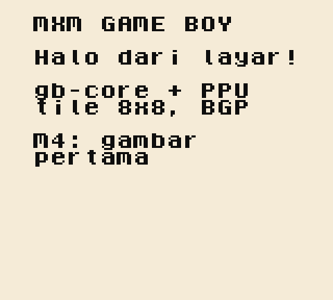

# Jurnal M4 — PPU dan gambar pertama di HP

- Periode: 2026-10-13
- Hasil: emulator menggambar layar sungguhan dan berjalan di browser HP
  pemilik, **5,3 ms per frame** (target `visi.md`: < 8 ms).

## Apa yang dibangun

| Bagian | Isi | PR |
|---|---|---|
| PPU | 154 baris × 456 siklus, mode 2/3/0/1, `LY` sungguhan, V-blank, STAT (tepi naik), background, `SCX`/`SCY`, `BGP`, OAM DMA | #21 |
| Model PPU | ADR-0012: digambar per baris; framebuffer tingkat kegelapan 0–3 | #21 |
| Golden test | `homebrew/layar` (printf ke layar) + `screen.hash` setelah 60 frame | #21 |
| Browser | `Emulator` di `gb-web`, canvas + palet MXM, akumulator waktu, tombol "Muat ROM", ROM demo dibuild CI | #22 |

## Status bukti

| Bukti | Status |
|---|---|
| CI (5 job) hijau | ✅ |
| 11/11 Blargg dengan `LY` sungguhan (stub M2 dibayar) | ✅ |
| Golden test layar, deterministik di laptop dan CI | ✅ |
| Chromium headless, emulasi 360 px: layar, 0,6 ms/frame, tanpa scroll | ✅ |
| ROM Blargg lewat tombol "Muat ROM": "Passed" tampil di layar | ✅ |
| **HP Android pemilik**: layar tampil, `build 99b1334`, **5,3 ms/frame** | ✅ |

## Angka

| Ukuran | Nilai |
|---|---|
| Tes `gb-core` / `gb-web` | 124 / 4 |
| Waktu emulasi per frame | desktop 0,6 ms · **HP pemilik 5,3 ms** (±9× lebih lambat) |
| ROM Blargg terberat (headless, release) | 0,11 s → 0,47 s setelah PPU per siklus |

## Pelajaran

1. **Batas waktu harus dicek dari dua sisi.** "Mode 3 = 160 siklus" lolos
   dari semua lapisan karena tes hanya memeriksa mode *sudah* berganti
   setelah batas, tidak memeriksa mode *belum* berganti sebelumnya.
2. **Stub adalah utang yang harus dicatat.** `LY = 0x90` dari M2 tercatat di
   jurnal M2 dan dibayar di sini; 11/11 Blargg membuktikan penggantinya benar.
3. **Core tidak tahu warna.** Framebuffer 0–3; palet MXM hidup di CSS.
   Mengganti warna seluruh layar tidak menyentuh Rust (ADR-0012).
4. **Ukur di perangkat sasaran.** Desktop 0,6 ms terasa "sangat cepat";
   HP 5,3 ms menunjukkan sisa ruang hanya ±1,5×. Tanpa angka HP, kita akan
   salah menilai.
5. **Program pihak ketiga menguji jalur yang tidak kita pikirkan.** ROM
   Blargg menggulir layar dengan `SCY`; lewat tombol "Muat ROM", fitur scroll
   ikut terbukti tanpa tes khusus.

## Batasan yang disadari (ADR-0012)

- Efek di tengah baris tidak ditiru; mode 3 selalu 172 siklus.
- VRAM/OAM tidak dikunci selama mode 2/3.
- Window dan sprite belum ada (M5).
- PPU dihitung per siklus: titik panas kinerja pertama kalau HP melambat.

## Latihan

1. Ganti `--lcd-0..3` di `web/style.css` dengan hijau DMG, build lokal,
   lihat seluruh layar berubah tanpa menyentuh Rust.
2. Ubah teks `homebrew/layar/main.c`. Golden test gagal; kapan mengubah
   `screen.hash` itu benar, dan kapan berbahaya?

## Berikutnya: M5 — sprite, window, tombol

Sprite (OAM, 8×8/8×16, flip, prioritas, batas 10 per baris), window, register
joypad + interrupt, tombol sentuh di HP dan keyboard, serta homebrew C yang
bisa dimainkan.
