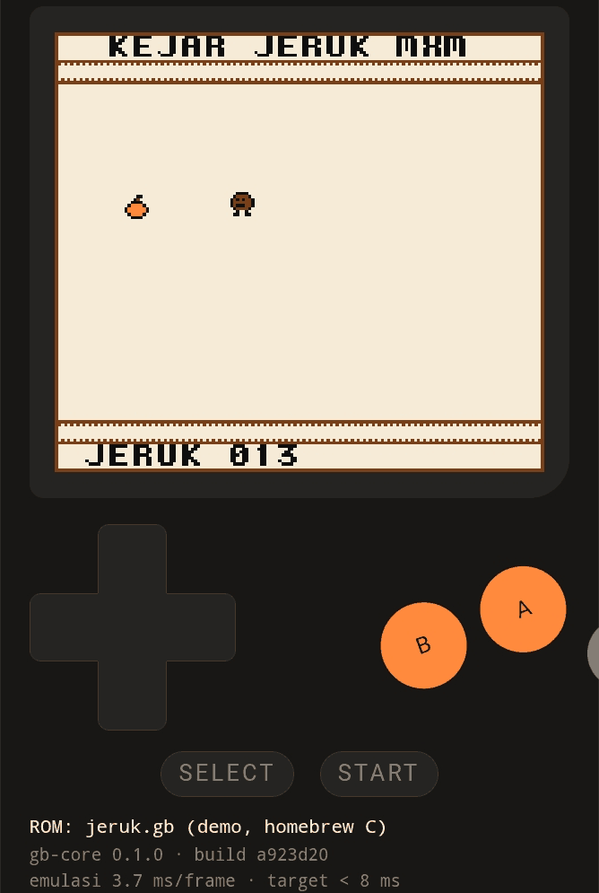

# Jurnal M5 — sprite, window, tombol, dan game pertama

- Periode: 2026-10-13
- Hasil: game C buatan sendiri, **Kejar Jeruk**, dimainkan dengan tombol
  sentuh di HP pemilik sampai **skor 13**, emulasi **3,7 ms per frame**
  (target `visi.md`: < 8 ms).



## Apa yang dibangun

| Bagian | Isi | PR |
|---|---|---|
| Sprite | OAM, 8×8/8×16, cermin X/Y, OBP0/OBP1, di belakang BG, maks 10 per baris, X kecil menang | #24 |
| Window | WX−7, WY, penghitung baris sendiri (hanya naik saat digambar) | #24 |
| Joypad | Register P1 (dua grup, ditekan = 0), interrupt saat tombol baru ditekan | #24 |
| Golden `sprite` | 4 huruf F (biasa, cermin X, cermin Y, OBP1) + window | #24 |
| `gb-web` | `setButtons(mask)` | #25 |
| `web/input.js` | D-pad 8 arah (jari boleh bergeser), A/B, Select/Start, multi-touch, keyboard; tombol dilepas saat tab disembunyikan | #25 |
| Game | `homebrew/jeruk`: Kejar Jeruk (sprite, skor di window, lari, jeda) | #25 |
| Golden dengan tombol | `gb-headless --hold`, `screen.hash` multi-baris: 5 kasus jeruk | #25 |

## Alur input

```
jari / keyboard → input.js → bit tombol → Emulator.setButtons (gb-web)
               → GameBoy::set_buttons (gb-core) → register P1 → game C
```

Tiap lapisan hanya tahu tetangganya: `input.js` tidak tahu P1, `gb-core`
tidak tahu jari. Ini pola ports & adapters yang sama dengan layar di M4,
hanya arahnya terbalik (masuk, bukan keluar).

## Status bukti

| Bukti | Status |
|---|---|
| CI (5 job) hijau di #24 dan #25 | ✅ |
| Uji mutasi M5·1: 12 bug ditanam, 12 tertangkap | ✅ |
| Bug joypad ditanam di `gb-core` → golden `jeruk` gagal | ✅ |
| Chromium ukuran HP: pointer di D-pad menggerakkan robot, Enter = jeda | ✅ |
| **HP Android pemilik**: build `a923d20`, sprite + window tampil benar | ✅ |
| **HP Android pemilik**: tombol sentuh, Kejar Jeruk sampai skor 13 | ✅ |

## Angka

| Ukuran | Nilai |
|---|---|
| Tes `gb-core` / `gb-web` / `gb-headless` | 147 / 5 / 1 |
| Golden test layar | 7 (layar 1, sprite 1, jeruk 5) |
| Waktu emulasi per frame | desktop 0,6 ms · **HP pemilik 3,7–3,9 ms** |

Catatan jujur soal angka HP: 3,7 ms lebih cepat daripada 5,3 ms di M4,
padahal PPU sekarang mengerjakan lebih banyak (sprite + window). Penyebabnya
belum diukur. Dugaan: kondisi HP (suhu, mode hemat daya, tab lain) dan isi
layar yang berbeda. Yang pasti hanya: keduanya di bawah target 8 ms.

## Pelajaran

1. **Tes hijau belum tentu tes yang kuat.** Tiga mutasi lolos di putaran
   pertama M5·1. Bukan kodenya yang salah; tesnya tidak bisa membedakan dua
   keadaan (warna sprite = warna BG, tile genap, baris window sama-sama
   kosong). Uji mutasi menemukan tes yang lemah.
2. **Golden test hanya mengunci, tidak membuktikan.** Hash `sprite` dan
   `jeruk` dikunci *setelah* gambarnya dilihat. Panah pertama simetris
   atas-bawah, jadi cermin Y tidak terlihat; diganti huruf F.
3. **C di SDCC bukan C standar.** `printf("%c", ekspresi_int)` membaca
   argumen bergeser; layar bergulir dan berantakan. Bug ada di program C,
   bukan emulator — dan baru ketahuan karena gambarnya dilihat.
4. **Input harus diuji tanpa manusia juga.** `--hold` membuat CI bisa
   "menekan tombol". Bug joypad di core langsung membuat golden gagal.
5. **Bukti terakhir datang dari jari sungguhan.** Playwright membuktikan
   kabelnya tersambung; hanya skor 13 di HP yang membuktikan game bisa
   dimainkan.

## Batasan yang disadari

- Interrupt joypad diminta saat tombol apa pun baru ditekan, tidak peduli
  grup mana yang dipilih (penyederhanaan, dicatat di `joypad.rs`).
- Prioritas sprite dihitung dari OAM saat baris digambar; perubahan OAM di
  tengah baris tidak ditiru (sama dengan batasan ADR-0012).
- Belum ada suara, belum ada simpan permainan, dan ROM masih 32 KiB tanpa
  MBC — game komersial besar belum bisa jalan (M6).

## Latihan

1. Di `homebrew/jeruk/main.c`, ubah kecepatan lari dari 2 menjadi 3. Kasus
   golden mana yang berubah, dan kenapa kasus `start` tidak ikut berubah?
2. Hapus `releaseAll` di `web/input.js`, build lokal, tahan tombol lalu
   pindah tab. Apa yang terjadi saat kembali?
3. Tulis `homebrew/fibonacci` (PR latihan Anda) lalu tambahkan
   `screen.hash`-nya sendiri.

## Berikutnya: M6 — cartridge

Header cartridge, MBC1 (bank ROM dan RAM), lalu MBC3/MBC5 seperlunya,
supaya ROM lebih besar dari 32 KiB bisa jalan. Termasuk RAM cartridge yang
disimpan di browser (simpan permainan), tetap tanpa ROM komersial di repo.
