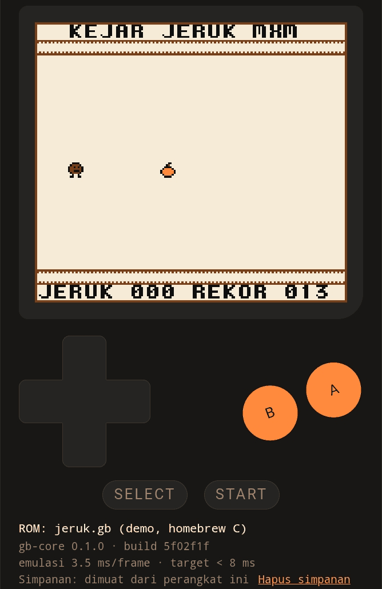

# Jurnal M6 — cartridge, MBC, dan simpan permainan

- Periode: 2026-10-13 – 2026-10-14
- Hasil: emulator menjalankan ROM lebih besar dari 32 KiB (MBC1/2/3/5), dan
  rekor Kejar Jeruk **bertahan setelah tab ditutup** di HP pemilik
  (rekor 013, build `5f02f1f`, **3,5 ms per frame**).



## Apa yang dibangun

| Bagian | Isi | PR |
|---|---|---|
| Cartridge | `cartridge.rs`: header, `enum Mbc` (MBC1, MBC2, MBC3 jam beku, MBC5), bank dari ukuran file | #27 |
| Keputusan | ADR-0013: enum, bukan `dyn Trait`; cartridge tak dikenal ditolak dengan pesan jelas | #27 |
| Bus | Bit I/O tak terpakai terbaca 1; register yang tidak ada di DMG (mis. KEY1) terbaca 0xFF | #27 |
| ROM uji | Konvensi Mooneye (3,5,8,13,21,34) di `gb-headless`; bundel `c-sp` v7.0 dikunci SHA-256 | #27 |
| Simpan | `take_ram_dirty` di core; `ram`/`loadRam`/`hasBattery` di gb-web; `web/save.js` | #28 |
| Keputusan | ADR-0014: localStorage, kunci judul + FNV-1a isi ROM, simpan ≤ 1×/detik dan saat tab ditutup | #28 |
| Game | Kejar Jeruk: MBC1 + RAM + baterai (`lcc.flags`), rekor dengan tanda `MXMJ` | #28 |

## Alur simpan permainan

```
game C menulis A000 → Cartridge (RAM + tanda berubah) → gb-web → save.js → localStorage
buka halaman → save.js → gb-web loadRam → Cartridge (sebelum frame pertama)
```

## Status bukti

| Bukti | Status |
|---|---|
| CI (5 job) hijau di #27 dan #28 | ✅ |
| ROM uji: 43 lulus + 1 gagal sesuai harapan (multicart) | ✅ |
| Blargg `cpu_instrs` gabungan (64 KiB, MBC1): 11/11 | ✅ |
| Uji mutasi M6·1: 10 bug ditanam, 10 tertangkap | ✅ |
| Chromium ukuran HP: rekor bertahan setelah muat ulang, hilang setelah "Hapus simpanan" | ✅ |
| **HP Android pemilik**: tab dibuka ulang, rekor 013 dimuat dari simpanan | ✅ |

## Angka

| Ukuran | Nilai |
|---|---|
| Tes `gb-core` / `gb-web` / `gb-headless` | 161 / 6 / 1 |
| ROM uji di manifest | 44 (Blargg 12, Mooneye 32) |
| Golden test layar | 7 (layar 1, sprite 1, jeruk 5) |
| Waktu emulasi per frame | **HP pemilik 3,5 ms** |

## Pelajaran

1. **Tes dulu, kode kemudian.** 31 ROM uji MBC dipasang sebagai "gagal
   sesuai harapan" sebelum satu baris MBC ditulis. Manifest yang gagal di
   kedua arah memberi tahu saat sesuatu lulus *terlalu cepat*.
2. **Uji yang lulus tanpa fiturnya tidak membuktikan apa-apa.**
   `mbc2-bits_unused` lulus sebelum MBC2 ada: tanpa RAM, semua bit terbaca 1.
3. **Gabungan menemukan yang tidak ditemukan bagian-bagiannya.** Kesebelas
   uji Blargg lulus sendiri-sendiri sejak M3, tetapi versi gabungannya macet:
   KEY1 terbaca 0x00, program mengira mesinnya Game Boy Color. Bug di bus
   sejak M1, baru ketahuan di M6.
4. **Uji efeknya, bukan pesannya.** Uji browser pertama hanya membaca teks
   "Simpanan: dimuat" — tetap lulus walau RAM tidak pernah dipasang ke game.
   Uji yang membaca piksel bilah skor langsung menangkapnya.
5. **Core tetap tidak tahu browser.** Simpan permainan butuh tiga pintu kecil
   di core (`ram`, `load_ram`, `take_ram_dirty`); localStorage, kunci, dan
   waktu menyimpan semuanya urusan adapter.

## Batasan yang disadari

- Jam MBC3 beku (ADR-0013): game yang bergantung waktu nyata melihat waktu
  tidak berjalan. Waktu nyata kelak masuk dari adapter.
- MBC1 multicart tidak didukung.
- MBC3 hanya dijaga tes unit; belum ada ROM uji MBC3 yang hasilnya bisa
  dibaca otomatis.
- Simpanan hilang kalau data situs browser dibersihkan; belum ada
  ekspor/impor file `.sav` (ADR-0014).
- Uji browser (Playwright) dijalankan manual, belum menjadi job CI.

## Latihan

1. Buka DevTools → Application → Local Storage di laptop. Temukan kunci
   simpanan Kejar Jeruk. Kenapa ada angka heksadesimal di belakang `JERUK`?
2. Ubah `mbc1-multicart_rom_8Mb.gb` di `tools/test-roms.tsv` menjadi `pass`,
   jalankan `tools/run-test-roms.sh`, dan baca pesannya.

## Berikutnya: M7 — suara

APU Game Boy: empat kanal (dua gelombang kotak, satu gelombang bebas, satu
noise), register NR10–NR52, dan pemutaran lewat Web Audio di browser. Core
tetap deterministik: APU menghasilkan sampel, adapter yang memutarnya.
